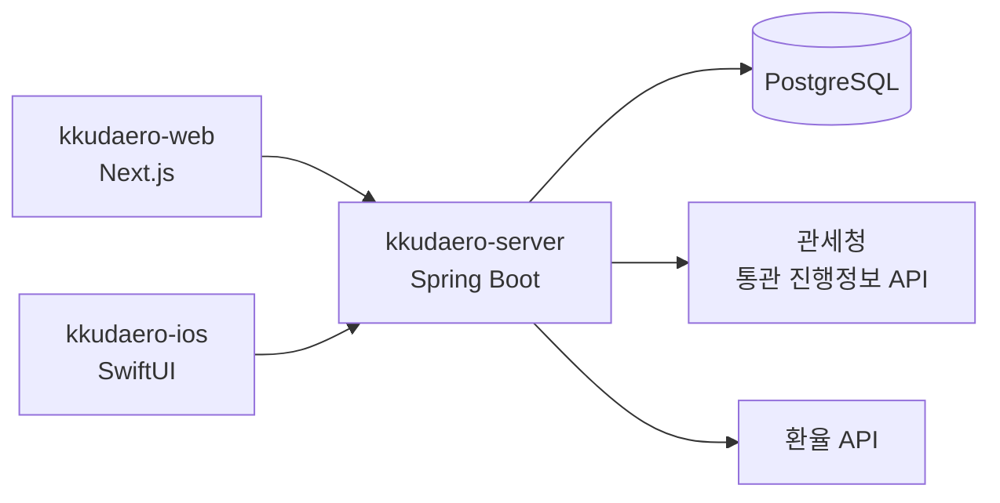

# 꾸대로 · kkudaero

**일본 구매대행, 처음이어도 주문한 그대로.**

일본 구매대행을 처음 시작하는 1인 사업자가 
첫 주문부터 통관까지 혼자 헤매지 않도록 돕는 도구를 만듭니다.

 

## 📦 꾸대로라는 이름

> **꾸**리다 + 구**대**(구매대행) + 그**대로**

짐도, 장사도 잘 꾸려서 주문한 그대로 도착하게.

 

## 🤔 왜 만드나요

구매대행을 처음 시작하면 이런 데서 막힙니다.

- 사업자등록, 통신판매업 신고, 전자상거래업자부호… **뭘 먼저 해야 하는지** 모르겠다
- 이 상품이 **150달러 목록통관** 대상인지, 관부가세가 얼마나 나올지 계산이 어렵다
- 통관이 멈췄는데 **지금 무슨 상황인지, 고객에게 뭐라고 해야 할지** 모르겠다

꾸대로는 이 막막함을 **체크리스트, 계산기, 통관 알림, 대응 매뉴얼**로 풀어 줍니다.

 

## ✨ 주요 기능

| 기능 | 설명 |
|---|---|
| ✅ 시작 체크리스트 | 사업자등록부터 첫 상품 등록까지 단계별 안내 |
| 🧮 관부가세·마진 계산기 | 150달러 목록통관 판정, 합산과세 경고, 예상 마진 |
| 🚚 통관 조회·알림 | 운송장번호로 통관 진행 상태 확인, 바뀌면 알림 |
| 📖 대응 매뉴얼 | 통관 보류, 통관부호 오류, 품절, 배송 사고 대응과 고객 안내 문구 |
| 📋 주문 추적 | 주문 → 해외 발주 → 배대지 → 송장까지 한눈에 |

> 관부가세는 모두 **예상치**로 제공하며, 통관 신고를 대행하지 않습니다.

 

## 🏗 구조

- 계산, 콘텐츠, 외부 API 연동, 개인정보 처리는 모두 **서버에서만** 합니다.
- 웹과 iOS는 서버의 **OpenAPI 명세**로 타입을 만들어 같은 규칙을 따릅니다.
- 개인통관고유부호 같은 개인정보는 **암호화해 저장**하고 로그에 남기지 않습니다.

 

## 📂 Repositories

| 저장소 | 설명 |
|---|---|
| [kkudaero-web](https://github.com/kkudaero/kkudaero-web) | 셀러가 쓰는 웹 서비스 |
| [kkudaero-ios](https://github.com/kkudaero/kkudaero-ios) | 알림 확인과 송장 입력을 위한 iOS 앱 |
| kkudaero-server | API 서버 (비공개) |

 

## 🚧 진행 상황

현재 **1단계(일본 구매대행 초보 셀러용 무료 웹 도구)** 를 개발하고 있습니다.

 

Made by [@dearosmar](https://github.com/dearosmar)

